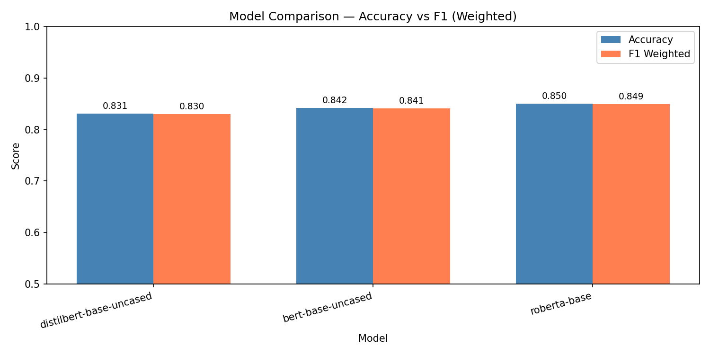
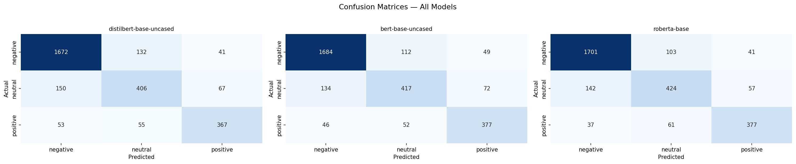

# Airline Tweet Sentiment Classification

Fine-tuning and comparing three transformer models (DistilBERT, BERT, RoBERTa) for
three-class sentiment classification on the Twitter US Airline Sentiment dataset.
Best result: **RoBERTa, 0.8489 weighted F1** on a held-out test set of 2,943 tweets.

## Quick start

### Option A — Google Colab (recommended)

The notebook was written for Colab and needs a GPU to train in reasonable time.

1. Open `Airline_Sentiment_Model.ipynb` in Colab.
2. **Runtime → Change runtime type → T4 GPU** (on CPU, training takes hours).
3. Download [`Tweets.csv` from Kaggle](https://www.kaggle.com/datasets/crowdflower/twitter-airline-sentiment)
   and upload it to the session — the Files panel puts it at `/content/Tweets.csv`,
   which is the path cell 4 already reads.
4. **Runtime → Run all.** Roughly 31 minutes for all three models.

### Option B — Local machine

```bash
git clone <this-repo>
cd AirlineSentiment

python3 -m venv .venv && source .venv/bin/activate   # Windows: .venv\Scripts\activate
pip install -r requirements.txt
```

Download [`Tweets.csv` from Kaggle](https://www.kaggle.com/datasets/crowdflower/twitter-airline-sentiment)
into the project root, then change the path in **cell 4** from the Colab default
to the local file:

```python
df = pd.read_csv('Tweets.csv')
```

```bash
jupyter notebook Airline_Sentiment_Model.ipynb
```

Run the cells top to bottom. Without a CUDA GPU this trains on CPU and takes
several hours — lower `epochs` in `train_and_evaluate`, or cut `MODEL_LIST`
(cell 17) down to `distilbert-base-uncased` alone, to get a result sooner.

Plots are written to `figures/`; the repo's committed copies come from the run
whose numbers appear below.

## Dataset

[Twitter US Airline Sentiment](https://www.kaggle.com/datasets/crowdflower/twitter-airline-sentiment)
(CrowdFlower, via Kaggle) — 14,640 tweets about US airlines, 15 columns. Only
`text` and `airline_sentiment` are used.

`Tweets.csv` is **not tracked in this repository**. Download it from the link
above and place it in the project root (or upload it to Colab) before running
the notebook.

| Sentiment | Count |
|-----------|-------|
| negative  | 9,178 |
| neutral   | 3,099 |
| positive  | 2,363 |

The classes are imbalanced (63% negative), so all reported metrics are
weighted averages.

### Split

Stratified, `random_state=42`:

| Split | Size |
|-------|------|
| Train | 10,248 |
| Validation | 1,449 |
| Test | 2,943 |

## Pipeline

1. **Cleaning** (`clean_text`) — lowercase; replace URLs with `<URL>` and
   `@handles` with `<MENTION>`; strip HTML-like tags, `#`, apostrophes and
   remaining non-alphanumerics; collapse whitespace.
2. **Encoding** — `negative: 0`, `neutral: 1`, `positive: 2`.
3. **Tokenization** — per-model `AutoTokenizer`, `max_length=128`, padded to max length.
4. **Fine-tuning** — Hugging Face `Trainer`, 3 epochs, batch size 16, lr `2e-5`,
   100 warmup steps, weight decay 0.01, evaluation each epoch on the validation split.
5. **Evaluation** — accuracy, weighted precision/recall/F1, confusion matrix, and
   error analysis on the test split.

## Results

Test-set performance (3 epochs each):

| Model | Accuracy | Precision | Recall | F1 (weighted) | Train time |
|-------|----------|-----------|--------|---------------|------------|
| distilbert-base-uncased | 0.8308 | 0.8287 | 0.8308 | 0.8296 | 6.4 min |
| bert-base-uncased | 0.8420 | 0.8405 | 0.8420 | 0.8410 | 12.3 min |
| **roberta-base** | **0.8502** | **0.8480** | **0.8502** | **0.8489** | 12.3 min |

**RoBERTa** is the best model. DistilBERT reaches ~98% of its F1 in half the
training time, making it the better choice if cost matters.




### Error analysis (RoBERTa)

441 / 2,943 test tweets misclassified (15.0%). Most confusions involve the
`neutral` class:

| True → Predicted | Count |
|------------------|-------|
| neutral → negative | 142 |
| negative → neutral | 103 |
| positive → neutral | 61 |
| neutral → positive | 57 |
| negative → positive | 41 |
| positive → negative | 37 |

Neutral is the hardest class: it is the fuzzy middle ground, and it is also
under-represented relative to negative. Remaining errors cluster on sarcasm
("lol i was sure id wake up to more of a response") and short, context-free
replies ("i sure will").

## Files

| File | Description |
|------|-------------|
| `Airline_Sentiment_Model.ipynb` | Full pipeline: EDA, cleaning, fine-tuning, evaluation, error analysis |
| `figures/model_comparison.png` | Accuracy vs. weighted F1 across the three models |
| `figures/confusion_matrices.png` | Test-set confusion matrix per model |
| `requirements.txt` | Python dependencies for a local run |

Not tracked in git (see `.gitignore`): `Tweets.csv` (download from Kaggle) and
the written report PDF.
